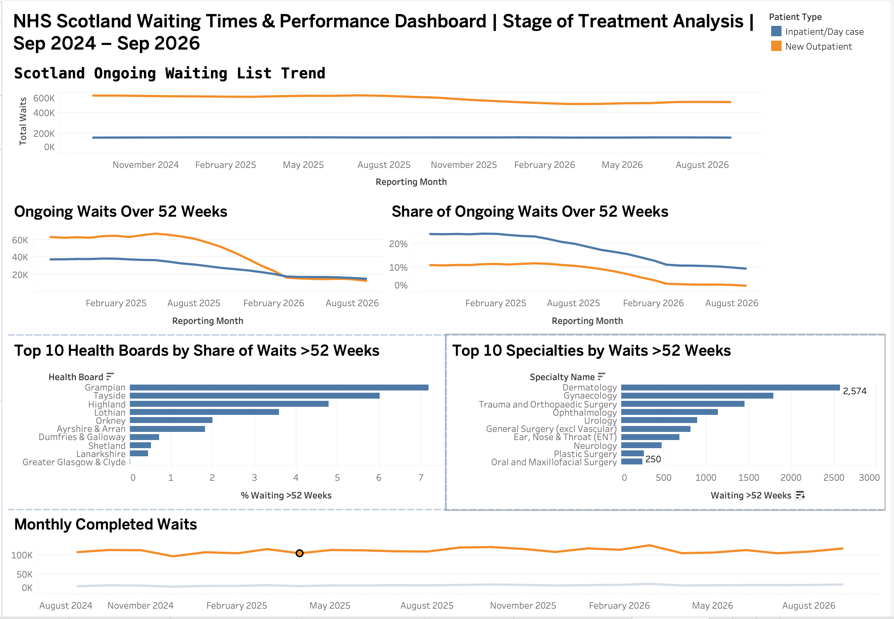

# NHS Scotland Waiting Times & Performance Analysis

An end-to-end data analytics project analysing **NHS Scotland Stage of Treatment waiting-time data from September 2024 to September 2026**.

The project uses **PostgreSQL, SQL, Tableau and Excel** to analyse national waiting-list trends, long waits, health board performance, specialty-level patterns and completed activity.

## Interactive Dashboard

[View the live Tableau dashboard](https://public.tableau.com/views/NHSScotlandWaitingTimesPerformanceDashboard/Dashboard1?:language=en-GB&publish=yes&:sid=&:redirect=auth&:display_count=n&:origin=viz_share_link)

## Project Objectives

The analysis aims to answer:

- How have ongoing waiting lists changed across Scotland?
- How have waits over 52 weeks changed over time?
- Which health boards have the highest share of long waits?
- Which specialties contribute most to the >52-week waiting backlog?
- How has completed activity changed over the analysis period?

## Tools Used

- **PostgreSQL** — database storage and querying
- **SQL** — data cleaning, validation, aggregation and analysis
- **Tableau Public** — interactive dashboard and data visualisation
- **Excel** — initial data inspection and CSV handling
- **DBeaver** — PostgreSQL database management and SQL development

## Dataset

**Source:** Public Health Scotland — Stage of Treatment Waiting Times

**Analysis period:** September 2024 – September 2026

**Raw dataset size:** 41,077 rows

The dataset contains monthly Stage of Treatment waiting-time information covering:

- NHS health boards
- Patient type
- Wait type
- Medical specialty
- Total waits
- Waits over 12 weeks
- Waits over 26 weeks
- Waits over 52 weeks
- Waits over 104 weeks
- Median waiting time
- 90th percentile waiting time
- Data quality flags

The analysis primarily focuses on **ongoing waits**, while completed waits are also analysed to understand changes in activity.

## Data Preparation & Validation

The raw CSV data was imported into PostgreSQL and retained in a raw table before creating a cleaned analytical view.

Key preparation steps included:

- Converting the reporting month from integer format into a PostgreSQL `DATE`
- Renaming fields into clearer analytical column names
- Checking for duplicate records
- Profiling missing values
- Investigating data-quality flags associated with missing observations
- Preserving missing values as `NULL` rather than incorrectly replacing them with zero
- Validating the reporting period across 25 consecutive monthly observations
- Identifying aggregate records to prevent double counting
- Creating health board and specialty lookup structures

A major validation step identified that the dataset contains both aggregate specialty records and individual specialty records. These were separated appropriately to prevent totals from being counted more than once.

## SQL Analysis

SQL was used throughout the project for cleaning, validation and analysis.

Techniques used include:

- `SELECT`
- `WHERE`
- `GROUP BY`
- `ORDER BY`
- `CASE`
- `COUNT`
- `MIN` / `MAX`
- `FILTER`
- `ROUND`
- `NULLIF`
- Type casting
- Date conversion
- `JOIN`
- Subqueries
- Common Table Expressions (CTEs)
- Views
- Lookup tables

The complete SQL analysis is available here:

[`nhs_waiting_times_analysis.sql`](nhs_waiting_times_analysis.sql)

## Key Findings

### National Waiting Lists

Between September 2024 and September 2026:

**New Outpatient ongoing waits**

- September 2024: **572,897**
- September 2026: **508,014**
- Change: approximately **-11.3%**

**Inpatient/Day Case ongoing waits**

- September 2024: **156,620**
- September 2026: **156,786**
- Change: approximately **+0.1%**

This shows that the New Outpatient waiting list reduced during the period, while the overall Inpatient/Day Case waiting list remained broadly stable.

### Long Waits Improved Substantially

The proportion of ongoing waits exceeding 52 weeks decreased considerably.

**Inpatient/Day Case**

- September 2024: **23.98%**
- September 2026: **9.61%**

**New Outpatient**

- September 2024: **11.08%**
- September 2026: **2.50%**

The improvement in long waits was therefore much stronger than the movement in the overall waiting-list size.

### Health Board Variation

For New Outpatient ongoing waits in September 2026, there was considerable variation between territorial health boards.

The highest shares of waits exceeding 52 weeks included:

- **Grampian — 7.18%**
- **Tayside — 6.01%**
- **Highland — 4.78%**
- **Lothian — 3.59%**

All 14 territorial health boards showed a lower New Outpatient >52-week share in September 2026 than in September 2024.

### Specialty-Level Backlog

The largest numbers of New Outpatient waits exceeding 52 weeks in September 2026 were concentrated in several specialties.

Leading specialties included:

- **Dermatology — 2,574**
- **Gynaecology — 1,791**
- **Trauma and Orthopaedic Surgery — 1,450**
- **Ophthalmology — 1,135**
- **Urology — 894**

The top five specialties accounted for approximately **61.8%** of the national New Outpatient >52-week backlog.

### Completed Activity

Comparing September 2024 with September 2026:

**Inpatient/Day Case completed waits**

- 20,338 → 24,657
- approximately **+21.2%**

**New Outpatient completed waits**

- 106,454 → 115,599
- approximately **+8.6%**

## Dashboard

The Tableau dashboard contains six visualisations:

1. Scotland ongoing waiting-list trend
2. Ongoing waits over 52 weeks
3. Share of ongoing waits over 52 weeks
4. Top health boards by share of waits over 52 weeks
5. Top specialties by number of waits over 52 weeks
6. Monthly completed waits

The dashboard combines national trends, long-wait performance, health board variation, specialty-level backlog and completed activity in a single view.

## Data Quality Considerations

Several considerations were important when interpreting the dataset:

- Missing observations were retained as `NULL` where data-quality flags were present.
- Aggregate specialty records were separated from individual specialties to avoid double counting.
- Specialty-level values do not necessarily sum exactly to national aggregate values.
- Waiting counts should be interpreted as published waiting records rather than assumed to represent unique individual patients.
- Differences between health boards are descriptive and should not be interpreted as evidence of underlying causes without additional analysis.

## Project Structure

    nhs-scotland-waiting-times-analysis/
    │
    ├── README.md
    ├── nhs_waiting_times_analysis.sql
    └── nhs_scotland_dashboard.png

## Skills Demonstrated

- SQL querying
- PostgreSQL
- Data cleaning
- Data validation
- Missing-data investigation
- Data quality assessment
- Relational joins
- Aggregate analysis
- CTEs and subqueries
- KPI calculation
- Trend analysis
- Health board benchmarking
- Specialty-level analysis
- Tableau dashboard development
- Data visualisation
- Communicating analytical findings

## Key Takeaway

The analysis indicates that NHS Scotland experienced a substantial reduction in long waits during the period examined, particularly for New Outpatient activity.

While the overall Inpatient/Day Case waiting list remained relatively stable, the proportion waiting more than 52 weeks fell significantly. New Outpatient waiting volumes also declined alongside a major reduction in long waits.

However, performance varied across health boards and specialties, highlighting areas where longer waits remained more concentrated by September 2026.

---

**Data source:** Public Health Scotland — Stage of Treatment Waiting Times

**Analysis period:** September 2024 – September 2026

**Dashboard:** [View on Tableau Public](https://public.tableau.com/views/NHSScotlandWaitingTimesPerformanceDashboard/Dashboard1?:language=en-GB&publish=yes&:sid=&:redirect=auth&:display_count=n&:origin=viz_share_link)
